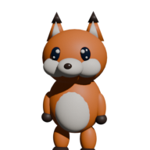
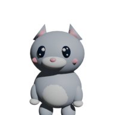
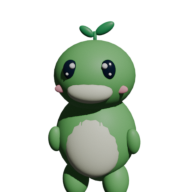
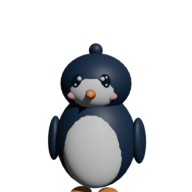

<p align="center">
  
</p>

<h1 align="center">Paw · 会干活的 AI 桌面宠物</h1>

<p align="center">
  一只住在你桌面角落的小家伙：能陪你聊天，也能帮你读文件、写小结、开团队会、操作电脑。<br>
  开源、免费，数据全部留在你自己的电脑上。
</p>

<p align="center">
  <a href="https://github.com/zcq1818/Agent-Paw/releases/latest"><b>⬇️ 下载 Windows 版</b></a> ·
  <a href="#常见问题">常见问题</a> ·
  <a href="#开发者指南">参与开发</a> ·
  <a href="https://cnb.cool/zcq18/Agent-Paw"><b>CNB 镜像仓库</b></a>
</p>

<p align="center">
  
  
  
  
  
</p>

## 它能做什么

**一只有性格的桌宠**
- 5 种 3D 形态（小狐狸、小猫、小恐龙、机器人、小企鹅），会走动、打盹、伸懒腰、跳舞，还会躲着你的鼠标
- 单击互动，双击聊天，拖到哪儿待在哪儿；可以设置活动范围、大小、透明度和免打扰时间
- 陪你专注：番茄钟专注会让它成长升级，解锁更长的专注时长

**把活儿丢给它**
- **拖文件给它**：Word、Excel、PPT、PDF、图片、代码都能读（PDF 和图片用 Windows 自带的离线文字识别），读完问你要总结、翻译还是交给谁处理
- **下班小结**：每天傍晚根据你今天用过的软件、完成的待办和专注时间写一份小结，可以直接发到 Slack 或 Jira
- **看你在用什么软件**：打开 Jira、Slack、代码编辑器、Office 时，适时问一句要不要帮忙（可以关掉）
- **操作电脑**：打开应用和网页、运行命令、读写文件、点击和输入——每一步动手前都会先问你

**一支 AI 小团队**
- 自己建团队成员：起名字、写人设、选形象、定权限，每个成员有自己的对话和记忆
- **房间**：把几个成员拉进一个房间讨论同一个问题，用 @名字 点谁谁回答，不 @ 就大家轮流发言
- **团队上桌面**：讨论时成员会出现在桌宠旁边，轮到谁谁冒泡
- **总管**：把一个任务同时交给多个模型（也可以交给本机的 Claude Code），让它们各自完成或互相挑错，再汇总

**CNB 协作：带一支 AI 开发队**
- 连上 [cnb.cool](https://cnb.cool) 的仓库，让 Paw 读代码、找出值得改的小问题，你勾选后自动建 Issue
- 一键交给 CNB 的 CodeBuddy NPC（工作模式）去改代码、开 PR
- NPC 开出 PR 后，Paw 用你配的模型自动审核，把意见发到 PR 上；不通过就让 NPC 按意见返工
- 审核通过后由你在 CNB 上合并，Paw 不会自己合并；聊天里也能说“在 CNB 上建个 Issue 让 CodeBuddy 去改”

**顺手的小工具**
- `Alt + Space` 快速启动器：拼音、首字母都能搜应用
- 记忆：自动记住你的偏好和重要的事，越用越懂你
- 技能（SKILL.md）和 MCP 连接器：一键登录 Slack、Jira、Notion、Linear、GitHub 等官方服务
- 待办、日程、今日新闻、剪贴板助手、屏幕理解

## 下载安装

1. 到 [Releases](https://github.com/zcq1818/Agent-Paw/releases/latest) 下载 `Paw_x.y.z_x64-setup.exe`
2. 双击安装，可以自己选安装位置（比如 `D:\Paw`）
3. 第一次打开后，右键桌宠 → **设置 → 模型**，填上你的模型服务：任何兼容 OpenAI 接口的服务都可以（填 Base URL、API Key 和模型名）

### 腾讯云 TDP 成员：直接用 TDP ModelGate

Paw 内置了 [TDP ModelGate](https://ai.tdp.fan)——由腾讯云 TDP 社群共建的模型网关，TDP 成员可以免费使用部分高级模型。

1. 浏览器打开 [ai.tdp.fan](https://ai.tdp.fan)，用 **TDP 一键登录** 进入控制台
2. 在密钥管理里新建一个 `sk-gw-` 开头的密钥
3. Paw 里 **设置 → 模型**，服务商选 **TDP ModelGate**，粘贴密钥，模型名填控制台里能看到的模型名

> 安装包暂时没有代码签名，Windows 可能会提示"Windows 已保护你的电脑"。点 **更多信息 → 仍要运行** 即可。源码完全公开，可以自己审查或自己打包。

**系统要求**：Windows 10 / 11（64 位）。

**更新**：Paw 会自动检查新版本，有更新时桌宠会问你，点一下就装好；也可以在 **设置 → 关于** 手动检查。

## 隐私与数据

- 聊天、记忆、设置、活动记录**全部保存在安装目录下的 `data` 文件夹**，不会上传到任何服务器。整个安装目录拷走，数据就跟着走
- 你的对话只会发给你自己在设置里填的模型服务商
- "看你在用什么软件"和活动时间线只在本机统计，可以随时关闭或清空
- 操作电脑、写文件、运行命令前都会弹确认；连接器（Slack、Jira 等）走官方 OAuth 登录，Paw 不会接触你的账号密码
- 卸载时程序会被删掉，`data` 文件夹会保留；不想要了手动删掉即可

## 常见问题

**需要付费吗？** Paw 本身免费开源（MIT）。模型调用按你自己选的服务商计费，很多服务商有免费额度；腾讯云 TDP 成员可以用 TDP ModelGate 的免费额度。

**支持 macOS / Linux 吗？** 目前只做了 Windows。读取 Office 文档、文字识别、操作电脑这些功能依赖 Windows 系统能力。

**杀毒软件报毒怎么办？** 没签名的新程序偶尔会被误报。可以从源码自己打包，或者在 Issues 里反馈。

**遇到问题或者有想法？** 欢迎到 [Issues](https://github.com/zcq1818/Agent-Paw/issues) 提。

## 开发者指南

### 本地运行

```bash
npm install
npm run dev          # 仅前端，浏览器预览：/ 为宠物，/?window=main 为工作台
npm run tauri:dev    # 完整桌面端
```

### 打包

```bash
npm run tauri:build
```

### 项目结构

```
├── src/                      前端（React 19 + zustand + Tailwind）
│   ├── App.tsx               按窗口 label 分流：pet → <Pet/>，main → 工作台
│   ├── agent/                Agent 内核（与 UI 无关的逻辑）
│   │   ├── kernel.ts         模型配置、系统提示词、基础工具、streamChat 工具调用循环
│   │   ├── tools.ts          待办/日程/快捷命令/剪贴板/系统动作等工具 + 审批确认
│   │   ├── multimodal.ts     语音、图片、截屏类工具
│   │   ├── memory.ts         IndexedDB 记忆库（提取、去重、检索、过期清理）
│   │   ├── personality.ts    用户画像与智能建议
│   │   ├── proactivity.ts    宠物主动行为调度（新闻、活动摘要、建议、自学 Skill）
│   │   ├── decision.ts       主动行为的计划选择（含冷却过滤）
│   │   ├── orchestrator.ts   总管：把任务拆给多个专家模型 / 本机 Claude 并汇总
│   │   ├── rooms.ts          房间里按 Bot 调用模型
│   │   ├── customSkills.ts   自定义 Skill 存储与 SKILL.md 导入导出
│   │   ├── news.ts           今日新闻抓取（RSS）与推送去重
│   │   ├── http.ts           跨域抓取（走 tauri-plugin-http，绕过 WebView CORS）
│   │   ├── security.ts       输入校验、限流、日志
│   │   ├── localClaude.ts    调用 Rust 侧 check_local_claude / run_local_claude
│   │   └── scope.ts …        按 Bot 分区 localStorage key 等小工具
│   ├── store/                zustand 状态
│   │   ├── agent.ts          发送消息：本地指令路由（记住/打开应用/卡片）→ streamChat
│   │   ├── chat.ts           会话与消息（按 Bot 分区持久化）
│   │   ├── bots.ts           Bot 通讯录、线程、审批请求
│   │   ├── activity.ts       本地活动观察（前台窗口统计）
│   │   ├── pet.ts / theme.ts / shortcut.ts / rooms.ts / experts.ts
│   │   └── windowSync.ts     两个窗口之间通过 storage 事件同步状态
│   ├── components/           UI：Pet、ChatPanel、Settings、BotRoster、RoomPanel …
│   └── utils/                宠物互动文案等
├── src-tauri/                Rust 后端（Tauri v2）
│   ├── src/lib.rs            命令：launch_app、system_action、get_active_window_info、
│   │                         check_local_claude、run_local_claude、窗口切换/拖拽
│   ├── src/tray.rs           托盘菜单
│   ├── capabilities/         权限；http:default 里是允许抓取的域名白名单
│   └── tauri.conf.json       两个窗口：pet（透明置顶）与 main（工作台，默认隐藏）
├── skills/                   示例 SKILL.md，可在 Skills 页导入
├── tools/pets/build_pets.py  用 Blender 生成带骨骼和动作的桌宠模型
└── public/models/pets/       *.glb（带骨骼的桌宠形态）与 thumbs/ 头像图
```

### 多个窗口的状态

`pet`、`main`、`launcher`、`squad` 是独立的 WebView，各有一份 zustand 状态，但共用 localStorage。
写入方保存到 localStorage，另一个窗口通过 `storage` 事件重新载入（见 `store/windowSync.ts`、
`store/bots.ts`、`store/theme.ts`）。新增需要跨窗口共享的状态时，记得接入同步。

### 桌宠模型（Blender）

`public/models/pets/*.glb` 由 `tools/pets/build_pets.py` 生成：所有形态共用一套骨骼
（hips / spine / head / ear / eye / arm / leg / tail），动作片段名与宠物状态一致
（idle、walk、sit、sleep、excited、thinking、dance、stretch、look、wave，另有可叠加的 blink），
由 `components/RiggedPet3D.tsx` 用 AnimationMixer 按状态交叉淡入播放。

```bash
blender -b --factory-startup -P tools/pets/build_pets.py -- public/models/pets [预览图目录] [只生成的形态,逗号分隔]
```

私人定制形象（比如照着家人照片做的）写在 `tools/pets/custom_pets.py`，输出到
`public/models/pets/custom/` 并生成 `manifest.json`，应用会自动列出；这两处都在 `.gitignore` 里，不会被提交。

### 访问第三方网站

WebView 里直接 `fetch` 不带 CORS 头的站点会被拦截。搜索、新闻等请求通过 `agent/http.ts`
走 `tauri-plugin-http`；新增来源时要同时在 `src-tauri/capabilities/default.json` 的
`http:default` 白名单里加上域名。

### 环境说明

- 默认面向 Windows 10/11
- 需要 Rust 和 Visual Studio C++ Build Tools（`build-with-msvc.ps1` 可自动配置 MSVC 环境）
- 可在设置中配置 OpenAI 兼容接口、API Key、Base URL 和模型名
- 依赖用 npm 管理（`package-lock.json`）

### 发布新版本（维护者）

1. 改 `src-tauri/tauri.conf.json`、`package.json`、`src-tauri/Cargo.toml` 里的版本号，更新说明写在 `release-notes/vX.Y.Z.md`
2. 提交并推送到 main。GitHub Actions（`.github/workflows/release.yml`）发现这个版本号还没发布过，就会在 Windows 机器上打包、签名，发布 `vX.Y.Z` 到 Releases，并附上 `latest.json`
   - 版本号没变的推送不会打包，也不会发版
   - 三处版本号对不上时会直接报错，不会发出去
   - 需要先在仓库 Settings → Secrets and variables → Actions 里添加 `TAURI_SIGNING_PRIVATE_KEY`（签名私钥的内容）
   - 想先试试能不能打包：在 Actions 页面手动运行 Release，只打包不发布，安装包在构建产物里下载

GitHub 用不了时也可以在本机发：`npm run tauri:build`（本机有签名私钥 `~/.tauri/paw-updater.key`，**绝不提交**）后 `npm run release -- --publish`。注意本机打包会带上 `public/` 里没进 git 的文件。

已安装的 Paw 会从 `releases/latest/download/latest.json` 发现新版本，用 `tauri.conf.json` 里的公钥校验签名后安装。

## 许可证

[MIT](LICENSE)
